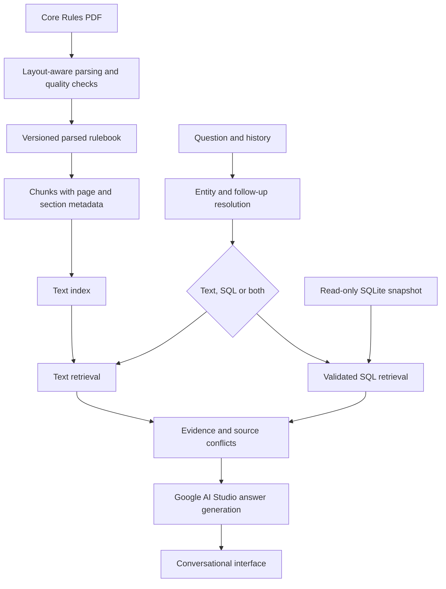

# Architecture

## Implementation status

Configuration, offline diagnostics, a Gemini connection check, read-only SQLite
access and the supplied rulebook's page-addressable parse are implemented.
An experimental Docling parser is retained under `experiments/docling/`.
Chunking, FTS5/BM25 retrieval, parameterized unit lookups and an offline retrieval
evaluation command are implemented. Gemini source routing and multi-turn conversation are available through the local
browser interface. Generated SQL and end-to-end answer evaluation remain under development.

## Target data flow

## Module boundaries

| Module | Responsibility |
|---|---|
| `config.py` | Typed settings, masked credentials and paths |
| `cli.py` | Command dispatch and offline diagnostics |
| `ingestion/` | Parsing, quality validation, chunking and indexing |
| `retrieval/` | Text search, SQL retrieval and structured evidence |
| `chat/` | State, routing, backend integration and answer generation |
| `evaluation/` | Reference datasets, metrics and run reports |

The planned evidence representation includes source kind, source identifier,
text or structured values, page/section or table/record identifiers, and retrieval
score where applicable. Raw SQL results remain distinct from answer prose.

## Runtime and tooling

Python 3.12 is the development interpreter; package metadata supports 3.12–3.13.
uv locks dependencies. Ruff handles linting and formatting, pytest runs offline
unit tests, and pre-commit checks changed Python files. Pydantic Settings reads
configuration. The Google Gen AI SDK supplies the backend integration; Rich and
prompt_toolkit are available for the terminal interface.

The parser uses PyMuPDF's native text blocks with a digest-guarded layout profile
for graphical tables and stratagem cards. See [ingestion.md](ingestion.md).
The embedding model, vector store, orchestration framework and evaluation library
remain open decisions. Advanced retrieval changes require comparison against a baseline.

## Data lifecycle

- `data/raw/`: immutable supplied corpus.
- `data/processed/`: versioned parsed text, structured records and chunks.
- `data/indexes/`: reproducible indexes excluded from Git.
- `evaluation/datasets/`: versioned, reviewed reference cases.
- `evaluation/reports/`: local run output; final findings belong in documentation.

Parsed records require stable identifiers, source hashes, page/section metadata
and links to relevant tables or figures. Chunking is reproducible from the saved
parse; indexing is reproducible from chunks. Raw database text is preserved, with
validated normalization limited to derived search/display fields.

## SQL access and source grounding

The connection utility uses SQLite URI `mode=ro`, `query_only`, and an authorizer
that denies ATTACH, DETACH and PRAGMA statements except the read-only
`data_version` counter required by FTS5. Connections close on exit.
This utility is not a complete execution boundary for arbitrary generated SQL.
The future SQL tool additionally requires statement validation, row limits,
execution budgets and bounded error recovery.

IDs remain strings. Ability retrieval must handle inline payloads and catalog
variants; cost retrieval must retain headings and alternative configurations.
Independent child relationships must not multiply result counts. See the
[database audit](data_audit.md) for verified examples.

PDF answers retain page citations; database answers retain exact record and
source identities. Conflicting versions are reported separately. Ambiguous unit
names require explicit assumptions or clarification. Missing evidence does not
justify invented statistics or rules.

## Evaluation

Unit tests run without credentials or network calls. Live model evaluation is a
separate workflow. Frozen reference cases cover text, SQL, combined evidence,
follow-ups, missing data and source disagreement. Run records include model and
configuration, evidence identifiers, generated SQL, answers, failures, latency
and token usage where available. Credentials are never logged.
