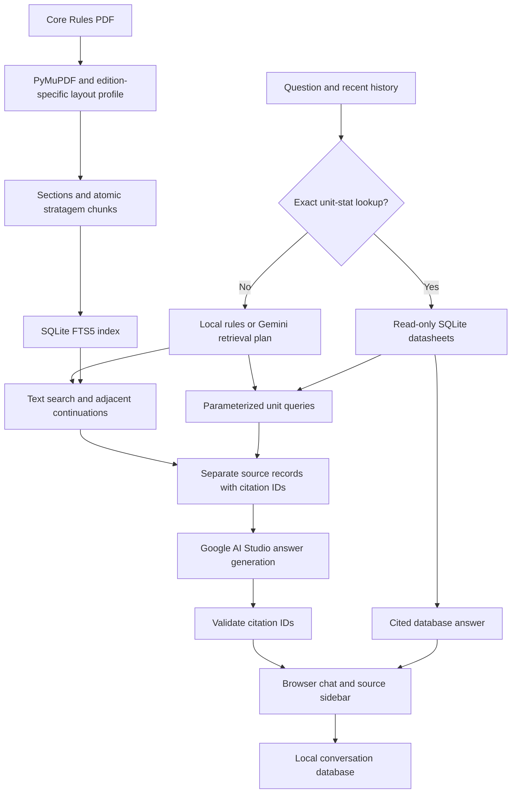

# Architecture and technical choices

Imperial Archive combines the supplied Core Rules PDF with a SQLite snapshot of
unit datasheets. It runs as a local Python application with a browser interface.
Google AI Studio supplies the language model. The source corpus and parsed
rulebook are included in the repository; search indexes are rebuilt locally.

## Request flow

## Decisions and their tradeoffs

| Choice | Reason | Limitation |
|---|---|---|
| Python, uv and a locked dependency file | One language handles PDF processing, SQLite, the API and evaluation; the lock file records the dependency versions | Initial setup needs network access; setup is documented for macOS and Linux |
| PyMuPDF with a source-hash-checked layout profile | Native PDF text is available, while graphical tables and stratagem cards need explicit layout handling | The profile applies only to the supplied edition; it is not a parser for arbitrary rulebooks |
| Section chunks and atomic stratagem records | A rule's timing, target, effect and restrictions should travel together | Some chunks are longer than the target size; illustrations are not fully represented as text |
| SQLite FTS5 with BM25 ranking | The small corpus can be searched locally without an embedding service, model download or separate database server | Lexical search can miss paraphrases and synonyms; no vector search or cross-encoder reranker is implemented |
| Adjacent same-heading context expansion | Conditions often continue across chunk boundaries; including neighbours reduces incomplete rule evidence | Extra context can lower precision and increase API input size |
| Fixed, parameterized SQLite queries | Unit statistics, keywords and abilities are structured facts; bounded queries preserve IDs and source records and prevent generated SQL from modifying the database | The system cannot answer arbitrary analytics or weapon-table queries |
| Direct answers for exact unit statistics | A unique datasheet already contains the requested value, so generation adds latency without adding evidence | Only a small set of exact question forms and statistics use this path |
| Local planning plus structured Gemini planning | Explicit rule or unit questions avoid an extra API request; follow-ups use recent history to resolve references | Model planning can still choose the wrong route or search terms |
| Google Gen AI SDK and Pydantic response schemas | The required Google AI Studio backend is configurable through two environment variables; structured responses are validated before display | Valid schemas and citation IDs do not prove that an answer is factually supported |
| A small Python HTTP server and plain browser assets | No frontend build step is needed to run or review the application | This is a single-user local application, not a production multi-user service |
| SQLite conversation storage | Questions, answers, source excerpts and drafts survive refreshes and restarts | History is local to one checkout and is not synchronized across computers |
| A checkpointed Gemini evaluation rubric | The existing SDK and schemas can score saved application responses and actual contexts with few additional dependencies | Scores are qualitative estimates, not official RAGAS metrics; using the same model to generate, answer and judge can introduce bias |

The evaluation method follows the lab's generate, review, run, save and score
workflow. Lab 3 labels its implementation examples as suggestions. This project
uses its own small evaluator instead of the demonstrated RAGAS adapters. The
choice keeps API requests and checkpoints explicit, but gives up RAGAS's standard
metric implementations. Results must therefore be interpreted using the rubric
in [evaluation.md](evaluation.md), not compared directly with published RAGAS scores.

## Evidence and source versions

Each retrieved record has a source kind, content, a local citation ID, a source
hash, and a PDF page or database record locator. Database records and PDF passages
remain separate. The supplied sources sometimes disagree, including grenade rules;
the answer instructions require the disagreement to be stated rather than merged
into a new rule. The application does not fetch current game rules to replace the
assignment's source snapshot.

The answer validator rejects unknown citation IDs and uncited factual paragraphs
when the model returns an answer. It does not check semantic support claim by
claim. Source review and answer evaluation are necessary for that distinction.

## API access, latency and failures

`GOOGLE_API_KEY`, `GOOGLE_MODEL` and `GOOGLE_REQUESTS_PER_MINUTE` are loaded from
local configuration. The browser never receives the key. Questions, recent
conversation history and selected evidence are sent to Google AI Studio.

A shared SQLite scheduler spaces calls from chat, generation, evaluation and the
connection check. It coordinates processes in one checkout. Transient HTTP errors
have bounded retries; authentication and quota errors are not retried. The
configured pacing, model latency and retries all contribute to response time.
Evaluation records answer latency and safe failure diagnostics. Token usage and
billing costs are not measured.

The server binds to loopback, serves a fixed set of assets, checks Host headers
and requires a per-process token for write requests. It is not intended to be
exposed to the internet. SQLite corpus access is read-only and uses parameterized
queries with bounded execution. Local chat history and credentials are ignored by
Git. See [chat.md](chat.md) for request and storage details.

## Code and data layout

| Location | Responsibility |
|---|---|
| `config.py`, `cli.py` | Settings, diagnostics and command entry points |
| `ingestion/` | PDF parsing, layout corrections and chunk construction |
| `retrieval/` | FTS5 search and read-only datasheet retrieval |
| `chat/` | Planning, cited answers, request pacing and conversation storage |
| `web/` | Local server and browser interface |
| `evaluation/` | Dataset generation and resumable answer scoring |
| `data/raw/` | Immutable supplied corpus |
| `data/processed/` | Versioned parse and chunks |
| `data/indexes/`, `data/local/` | Rebuildable index and private runtime state |
| `evaluation/datasets/` | Versioned questions and reviewed references |

Offline tests cover parsing, retrieval, source handling, citations, conversation
storage, HTTP request validation and evaluation checkpoints. They replace model
responses with deterministic substitutes. Live evaluation complements those tests
by measuring the configured model and the application's actual retrieved contexts.
